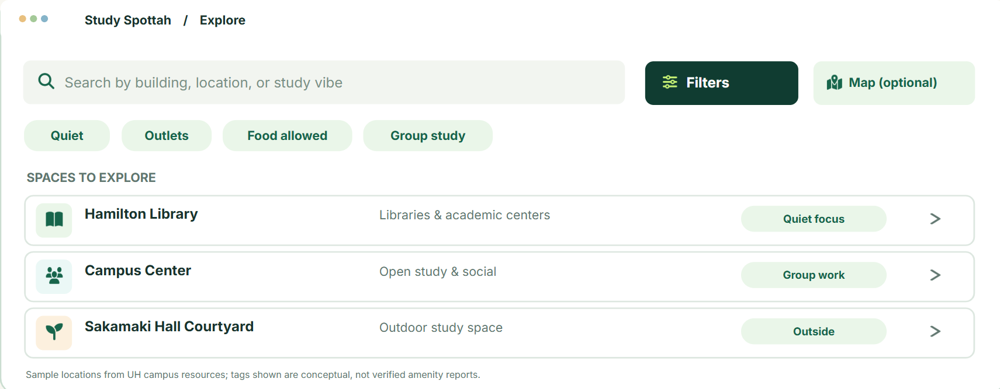
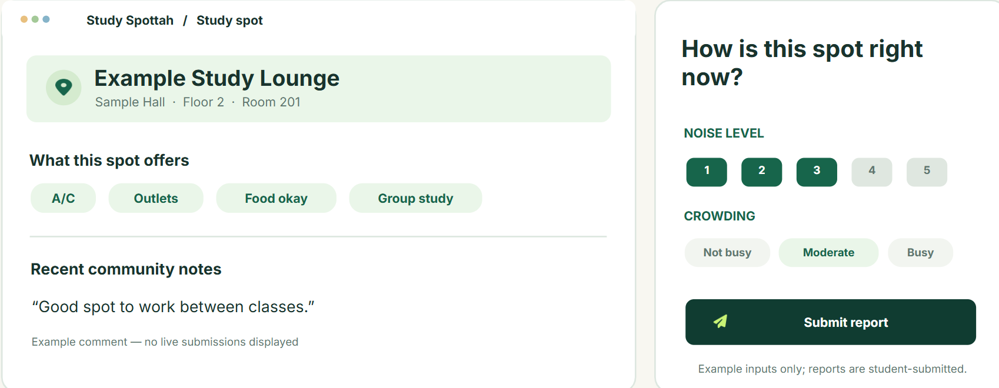
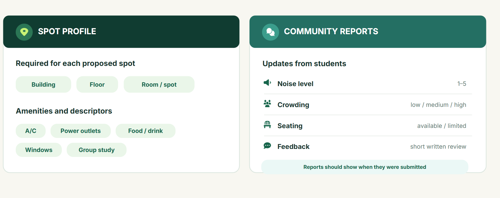

# Study Spottah

## Table of contents

* [Overview](#overview)
* [Link to Github Organization and repositories](#link-to-github-organization-and-repositories)
* [Team Contract](#team-contract)
* [Deployment](#deployment)
* [User Guide](#user-guide)
* [Community Feedback](#community-feedback)
* [Development History](#development-history)
* [Example enhancements](#example-enhancements)
* [Team](#team)

## Overview

Finding study spots on campus outside of the library can be hard, especially if you are looking for a specific vibe or certain amenities. Study Spottah is an application that will allow UHM students to ground source a list of “hidden gem” study spots and classify them by amenities and other descriptive labels. Users will be able to view and filter the table of different study spots and they could potentially propose new study spots or leave comments about the quality of the study. Some of these descriptive labels for a study spot include: 
- Location
- AC or not
- Food allowed or not
- Microwave
- Chargers
- Windows
- Group study allowed

There will also be a place for students to communicate about the current conditions of study spots around campus, which students can can upvote or downvote based on accuracy. Students may leave notes such as 
- Loudness levels
- Traffic (busy or not)
- Available seating
- Quiet Level (scale 1-5)

These will be cleared at the end of every day. 

## Link to Github Organization and repositories
* [Github organization (consonant soup)](https://consonant-soup.github.io/)
* [Study spottah](https://github.com/Consonant-Soup/Study-spottah)

## Team Contract 
* [consonant soup team contract](https://docs.google.com/document/d/1zLvfQsi138oT05DhuDPLJJZ2WlT4zhGeST0PmfX52yw/edit?usp=sharing)

## Deployment

* [Vercel - Github repo](https://github.com/Consonant-Soup/Consonant-Soup.github.io/tree/issue-1)

### User Guide
This section provides a walkthrough of the Study Spottah interface and its capabilities

### Landing Page

The landing page is first presented to the users when they visit the study spottah website. Here, users can see our mission, list of study spots around campus, and a quick summary of what study spottah offers. They can also view a list of incoming transit around the UH Manoa Campus, which are TheBus and the Rainbow Shuttle. 

### Sign in and sign up

To use study spottah advanced functionality like posting notes, downvoting and upvoting other users notes, and leaving feedback to study spots, users may click on the "sign in" button on the top right corner of the landing page. 

In the sign in page, an email address and password is required. 

If you don't already have an account, press the "sign up" at the bottom of the sign in page. Alongside an email address and password, it will also ask users to fill out a display name for their profile. 

### User Home page

Once users are signed in, users are taken into the home page. At the top of the page, there is a search bar where students can search for a study spot. 

### Filter page and Community reports

Beside the search bar is a filter where users can filter what amenities they want in a study spot. Addition to the filters, users can also see time-sensitive community reports for each location. 

### Study Spot profile and Review

Each study spot has a profile where users can see further information about the spot. Alongside the profile, users can click on a study spot profile and leave a time-sensitive report. There will be questions asking users of current noise level, business, seating availability, etc.

## Community Feedback

We are interested to hear your experience using Study Spottah! If you have any issues using the app please let up know.  

## Development History

### Milestone 1: Mockup development
* [Milestone 1](https://github.com/orgs/Consonant-Soup/projects/5)

### Milestone 2: 
* [Milestone 2](https://github.com/orgs/Consonant-Soup/projects/6)

## Example enhancements
- Users without or without an account may look for locations without signing up
- Users with an account may post notes about current study spot conditions
- Users with an account may upvote/downvote notes
- Users with an account may leave reviews or feedback to study spots
- Admins may edit study spot tags, delete or upload notes and ban users

## Team

Study Spottah is designed, implemented, and maintained by Mija Wheeler, Tishya Chhabra, Brian Yao, Trynt Gregory, and Lourine Lalican.
